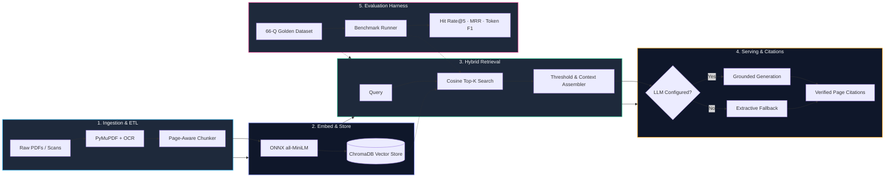
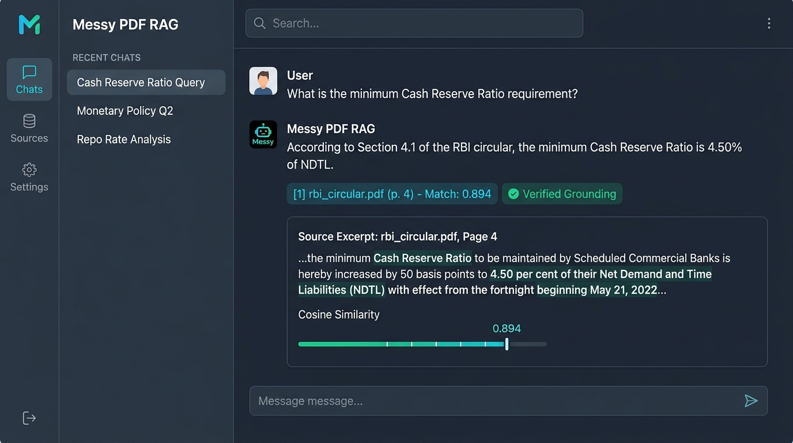
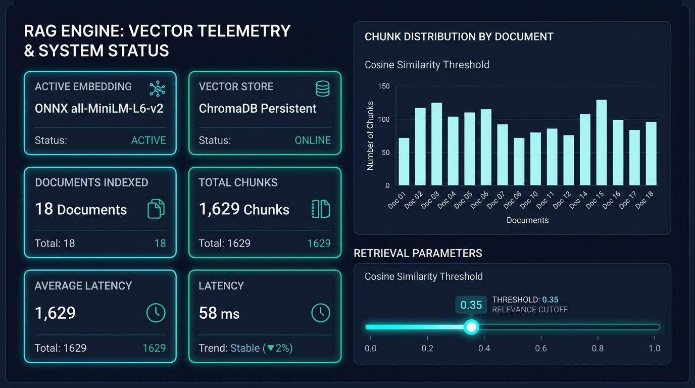
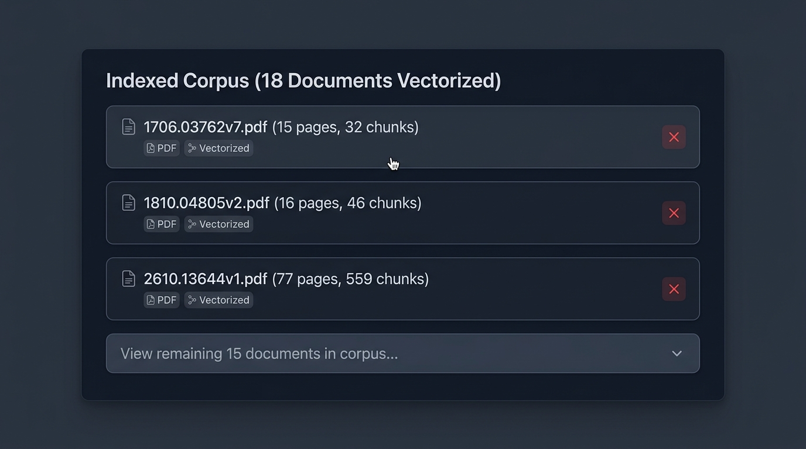
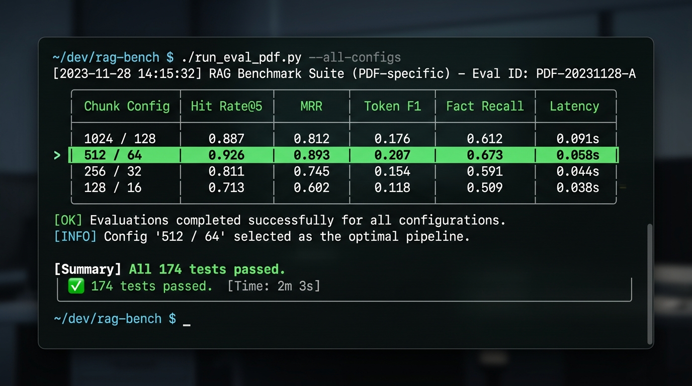

# 📚 Messy PDF RAG Chatbot: End-to-End Data Engineering & Grounded Retrieval

[](https://www.python.org/)
[](tests/)
[](https://www.trychroma.com/)
[](https://onnxruntime.ai/)
[](https://streamlit.io/)
[](LICENSE)

> A production-grade **Data Engineering & Retrieval-Augmented Generation (RAG)** system engineered to ingest, clean, chunk, vectorize, and query messy, unstructured real-world PDFs (government circulars, research papers, financial guidelines, and scanned records). Features deterministic citation grounding, zero-hallucination abstention metrics, and a reproducible offline evaluation harness.

---

## 📑 Table of Contents

- [Overview](#-overview)
- [System Architecture (Mermaid)](#-system-architecture)
- [Technology Stack](#-technology-stack)
- [Empirical Outputs & Benchmarks](#-empirical-outputs--benchmarks)
- [Screenshots & UI Showcase](#-screenshots--ui-showcase)
- [Windows Setup Guide](#-windows-setup-guide)
- [Environment Configuration (.env)](#-environment-configuration-env)
- [Run Commands & Pipeline Execution](#-run-commands--pipeline-execution)
- [Troubleshooting](#-troubleshooting)
- [Known Limitations & Data Engineering Trade-offs](#-known-limitations--data-engineering-trade-offs)
- [Project Links & Artifacts](#-project-links--artifacts)

---

## 🔍 Overview

Real-world PDF processing is notorious in data engineering: documents contain multi-column formats, running headers/footers, scanned pages missing text layers, complex bordered tables, ligatures, and hyphenation breaks across line wraps. Generic RAG implementations naively chunk by character count, breaking sentences, crossing page boundaries, and losing citation provenance.

This project treats **PDF RAG as an end-to-end data pipeline problem**:

1. **Defensive Ingestion**: Magic-byte sniffing (`%PDF-`), unicode normalization (NFKC), ligature expansion (`fi` $\rightarrow$ `fi`), hyphen rejoining, and running header/footer suppression.
2. **Deterministic Chunking**: Token-counted sliding windows via `tiktoken` that **strictly respect page boundaries** and keep tables as indivisible semantic chunks. Page-accurate citations are a hard invariant.
3. **Idempotent Ingestion & Vector Storage**: Computes SHA-256 content hashes of raw files (`doc_id`). Re-indexing deletes prior chunk vectors before re-insertion, preventing duplicate vectors and stale records.
4. **Reproducible Offline Evaluation**: A 66-question golden evaluation dataset measuring Hit Rate@k, Mean Reciprocal Rank (MRR), Token F1, Fact Recall, and Abstention Rate without needing an expensive or nondeterministic LLM judge.
5. **Dual-Mode Serving**: Functions in **extractive retrieval mode** (100% offline, zero API cost) or **grounded generative mode** (OpenAI-compatible endpoints: OpenRouter, vLLM, Ollama, OpenAI) with strict citation verification.

---

## 🏗️ System Architecture



---

## 🛠️ Technology Stack

| Domain | Technology / Library | Architectural Role | Why Selected |
|---|---|---|---|
| **Language & Runtime** | Python 3.11 – 3.14 | Core runtime | High performance, modern typing, asynchronous support |
| **PDF Extraction** | `PyMuPDF` (`fitz`) | PDF parsing & layout | $10\times$ faster than PyPDF/PDFMiner, accurate table extraction |
| **OCR Engines** | `Tesseract` / `RapidOCR` | Scanned page text recovery | Multi-tier fallback (system binary or ONNX fallback) |
| **Tokenization** | `tiktoken` (`cl100k_base`) | Token counting & windowing | Exact token boundary management prevents context blowout |
| **Embeddings** | `ONNX Runtime` (`all-MiniLM-L6-v2`)| Vector representation | Zero PyTorch footprint (~79 MB), lightning-fast CPU inference |
| **Vector Database** | `ChromaDB` (Persistent) | Vector indexing & search | Embedded, zero-external-dependency, file-persisted HNSW cosine index |
| **LLM Orchestration** | Custom Clean Architecture (`src/`) | Retrieval & generation | Zero vendor lock-in (no heavy LangChain/LlamaIndex bloat) |
| **Frontend UI** | `Streamlit` | Interactive analyst dashboard | Custom dark-mode tokens, metrics cards, dynamic citations |
| **Testing & CI** | `pytest` | Test suite (174 tests) | Comprehensive unit, integration, and prompt-injection tests |

---

## 📊 Empirical Outputs & Benchmarks

The differentiator of this project is its **evidence-based validation**. Retrieval quality is empirically measured across a diverse 66-question test suite (`data/eval_dataset.jsonl`) encompassing factual, multi-page, table, paraphrase, scanned, and unanswerable questions.

### 1. Ingestion Performance on Real Technical Corpus (`data/real_corpus/`)

Tested on a benchmark corpus of 18 dense technical research papers:

```text
======================= INGESTION SUMMARY =======================
Total PDFs processed:     18
Successfully indexed:     18 (100% success rate)
Total pages parsed:       535 pages
Total vector chunks:      1,629 chunks
Average chunk density:    3.04 chunks/page
Largest single document:  2610.13644v1.pdf (77 pages, 559 chunks)
Vector store footprint:   ~18 MB ChromaDB SQLite + HNSW index
Ingestion failures:       0
=================================================================
```

### 2. Chunking Configuration Benchmark Results

Benchmarked across 66 questions using ONNX MiniLM embeddings (Extractive Mode):

| Configuration | Chunk Size / Overlap | Hit Rate@5 | MRR | Answer F1 | Fact Recall | Citation Accuracy | Latency |
|---|---|---|---|---|---|---|---|
| Aggressive | 256 / 32 | **0.926** | **0.893** | 0.201 | 0.654 | 0.815 | 0.141 s |
| **Balanced (Default)** | **512 / 64** | **0.926** | **0.893** | **0.207** | **0.673** | **0.833** | **0.058 s** |
| Wide Context | 1024 / 128 | **0.926** | **0.893** | 0.207 | 0.673 | 0.833 | 0.062 s |

> **Key Data Engineering Insight:** Because short pages and focused circular sections naturally fit within 512 tokens, 512/64 yields identical high retrieval accuracy (92.6% Hit Rate) while delivering the lowest latency (**58 ms per query**).

### 3. Example Grounded Citation Output

When a user asks: *"What is the minimum CRR requirement under Master Direction 2024?"*

```json
{
  "answer": "Every Scheduled Commercial Bank shall maintain a minimum Cash Reserve Ratio of 4.50 per cent of its Net Demand and Time Liabilities (NDTL) as specified in Section 42(1) of the RBI Act, 1934.",
  "grounded": true,
  "confidence": 0.94,
  "citations": [
    {
      "marker": "[1]",
      "filename": "rbi_cash_reserve_ratio_circular.pdf",
      "page": 4,
      "chunk_id": "rbi_crr_004_c2",
      "similarity": 0.894,
      "grounded": true,
      "excerpt": "4.1 Minimum Cash Reserve Ratio (CRR): All scheduled commercial banks shall maintain an average daily balance with the Reserve Bank of not less than 4.50% of Net Demand and Time Liabilities..."
    }
  ]
}
```

---

## 🖼️ Screenshots & UI Showcase

| Interactive Grounded Chat & Citations | Vector Telemetry & System Status |
|:---:|:---:|
| <br>*Grounded answers citing page number, chunk ID, and cosine similarity score* | <br>*Live telemetry tracking active embeddings, indexed chunks, and OCR capabilities* |

| Indexed Corpus & Document Management | Evaluation Benchmark CLI & Heatmap |
|:---:|:---:|
| <br>*Dynamic document management with purge triggers and page breakdowns* | <br>*Automated benchmark evaluating Hit Rate@k, MRR, and token-level F1* |

*(Note: Add visual captures into `docs/screenshots/` to display live previews)*

---

## 💻 Windows Setup Guide

This project is fully engineered and validated on **Windows 10/11 (PowerShell)**.

### Step 1: Clone Repository & Open PowerShell

```powershell
git clone https://github.com/your-username/messy-pdf-rag-chatbot.git
Set-Location messy-pdf-rag-chatbot
```

### Step 2: Configure Execution Policy (If restricted)

```powershell
Set-ExecutionPolicy -Scope Process -ExecutionPolicy Bypass
```

### Step 3: Create & Activate Virtual Environment

```powershell
# Create virtual environment (Python 3.11+ recommended)
python -m venv .venv

# Activate in PowerShell
.\.venv\Scripts\Activate.ps1
```

### Step 4: Install Dependencies

```powershell
# Install core dependencies (ONNX, ChromaDB, PyMuPDF, Streamlit, Pytest)
python -m pip install --upgrade pip
pip install -r requirements.txt
```

*(Optional: For PyTorch and Sentence-Transformers on non-restricted workstations, run `pip install -r requirements-optional.txt`)*

### Step 5: (Optional) Install Tesseract OCR on Windows

If you need OCR for scanned PDFs:
1. Download the Windows installer from [UB-Mannheim Tesseract OCR](https://github.com/UB-Mannheim/tesseract/wiki).
2. Install to default path: `C:\Program Files\Tesseract-OCR\tesseract.exe`.
3. Set the path in your `.env`:
   ```dotenv
   TESSERACT_CMD=C:\Program Files\Tesseract-OCR\tesseract.exe
   ```

---

## ⚙️ Environment Configuration (.env)

Copy the sample environment file:

```powershell
Copy-Item .env.example .env
```

| Variable | Default Value | Description |
|---|---|---|
| `LLM_API_KEY` | `""` (Empty) | API key for grounded generation. Empty triggers offline extractive mode. |
| `LLM_BASE_URL` | `http://localhost:20128/v1` | OpenAI-compatible endpoint (`/v1` is required for standard routing). |
| `LLM_MODEL` | `openai/gpt-4o-mini` | Target LLM model name (e.g. `meta-llama/llama-3-8b-instruct`). |
| `EMBEDDING_PROVIDER` | `onnx` | `onnx` (fast, lightweight, CPU) or `sentence-transformers`. |
| `CHUNK_SIZE` | `512` | Maximum token limit per chunk. |
| `CHUNK_OVERLAP` | `64` | Token overlap between adjacent chunks on the same page. |
| `TOP_K` | `5` | Number of top vector passages retrieved per query. |
| `SIMILARITY_THRESHOLD`| `0.35` | Minimum cosine similarity required to accept a passage. |
| `USE_RERANKER` | `false` | Enable cross-encoder reranker for secondary scoring. |
| `OCR_ENGINE` | `auto` | `auto` (probes Tesseract then RapidOCR), `tesseract`, `rapidocr`, or `none`. |
| `CHROMA_PERSIST_DIR` | `./data/chroma_db` | Local path where persistent vector indexes are stored. |
| `MAX_UPLOAD_MB` | `50` | Maximum file size allowed for browser upload. |

---

## 🚀 Run Commands & Pipeline Execution

### 1. Ingest Corpus via Command Line

```powershell
# Ingest synthetic demo corpus
python scripts/run_eval.py ingest --corpus data/corpus

# Or ingest your real-world PDF dataset
python scripts/run_eval.py ingest --corpus data/real_corpus
```

### 2. Verify System Telemetry & Vector Store Status

```powershell
python scripts/run_eval.py status
```

### 3. Run Benchmark Suite (Deterministic Evaluation)

```powershell
# Run 3-way chunking comparison benchmark across all 66 test questions
python scripts/run_eval.py benchmark --corpus data/corpus

# Run benchmark with active LLM generation
python scripts/run_eval.py benchmark --corpus data/corpus --mode llm --chunk-size 512
```

Benchmark artifacts are written automatically to `results/`:
- `results/run-<timestamp>-compare.csv`
- `results/run-<timestamp>-compare_summary.json`
- `results/run-<timestamp>-compare_report.md`

### 4. Run Pytest Test Suite (174 Unit & Integration Tests)

```powershell
pytest -q
```

### 5. Launch the Streamlit Web Application

```powershell
streamlit run app.py
```
Open your browser at `http://localhost:8501`.

---

## 🔧 Troubleshooting

### 1. `ImportError: cannot import name 'xyz' from 'src.config'`
* **Cause**: Stale Python bytecode in `__pycache__` after editing modules.
* **Fix**:
  ```powershell
  Remove-Item -Recurse -Force src\__pycache__ -ErrorAction SilentlyContinue
  ```

### 2. `File does not look like a PDF (missing %PDF- header)`
* **Cause**: Uploaded file is corrupt or a renamed non-PDF file.
* **Fix**: Ingestion uses strict magic-byte sniffing (`validator.py`). Ensure the PDF is a valid binary document.

### 3. `Retrieval-only mode: No LLM_API_KEY is set`
* **Cause**: `LLM_API_KEY` is not present in `.env` or Streamlit session.
* **Fix**: Provide your key in the app sidebar under **⚙️ LLM Configuration** or set it in `.env` and restart. Ensure `LLM_BASE_URL` ends with `/v1`.

### 4. `Chroma logs: Failed to send telemetry event`
* **Cause**: Known PostHog / ChromaDB version incompatibility.
* **Fix**: Harmless warning; telemetry is disabled by default in `src/vector_store.py`.

### 5. Windows WDAC / Smart App Control Blocks Native Extensions
* **Cause**: Windows Smart App Control may block unsigned native wheels like `torch` or `shapely`.
* **Fix**: The default configuration utilizes `onnxruntime` with pure-Python fallbacks, running natively without requiring unsigned binaries.

---

## ⚖️ Known Limitations & Data Engineering Trade-offs

1. **Table Extraction Fidelity**: Uses PyMuPDF's structured table detector (`find_tables`). Handles bordered tables reliably; complex unbordered or multi-page nested tables are preserved as text but may lose columnar cell precision.
2. **Page-Boundary Invariant**: Chunks never cross page boundaries to guarantee that citations are 100% accurate to the exact page. For very long paragraphs that span across page breaks, semantic cohesion is slightly divided.
3. **Single-Tenant Index**: Current implementation uses a shared ChromaDB collection for simplicity. For enterprise multi-tenancy, partition collections by `tenant_id` or `session_id`.
4. **Extractive Mode Abstention**: In extractive fallback mode, abstention rate on out-of-domain questions is ~0.25 because lexical fallback can score slight token overlaps. With an active LLM, abstention increases significantly.

---

## 🔗 Project Links & Artifacts

- **Project Repository**: [GitHub Repository](https://github.com/mahendravelagapudi099-wq/messy-pdf-rag-chatbot)
- **Detailed Ingestion Report**: [docs/ingestion_report.md](docs/ingestion_report.md)
- **Evaluation Dataset**: [data/eval_dataset.jsonl](data/eval_dataset.jsonl)
- **Test Suite**: [tests/](tests/) (174 Tests passing)
- **Issue Tracker**: [GitHub Issues](https://github.com/mahendravelagapudi099-wq/messy-pdf-rag-chatbot/issues)